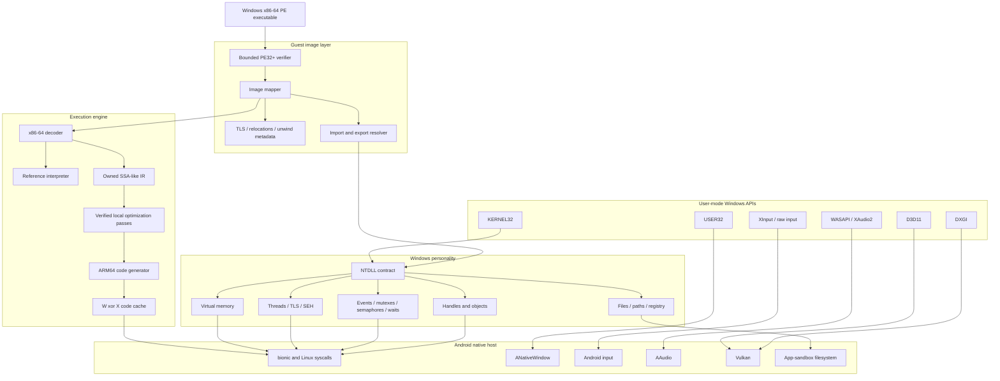

DBLYATEM ARCHITECTURE
====================

INVARIANT
---------

No guest byte becomes executable before structural verification, bounded
mapping, decode validation, and a write-to-execute permission transition.
